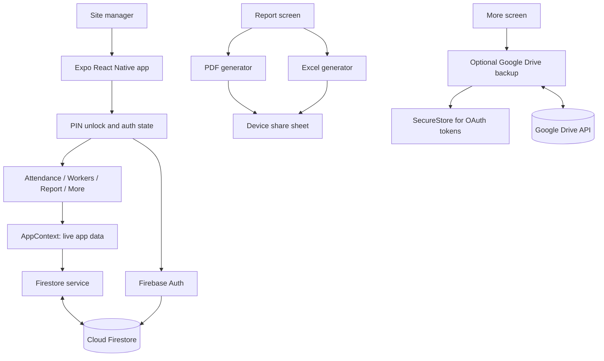
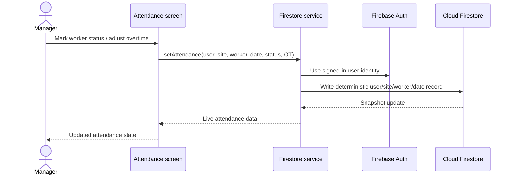
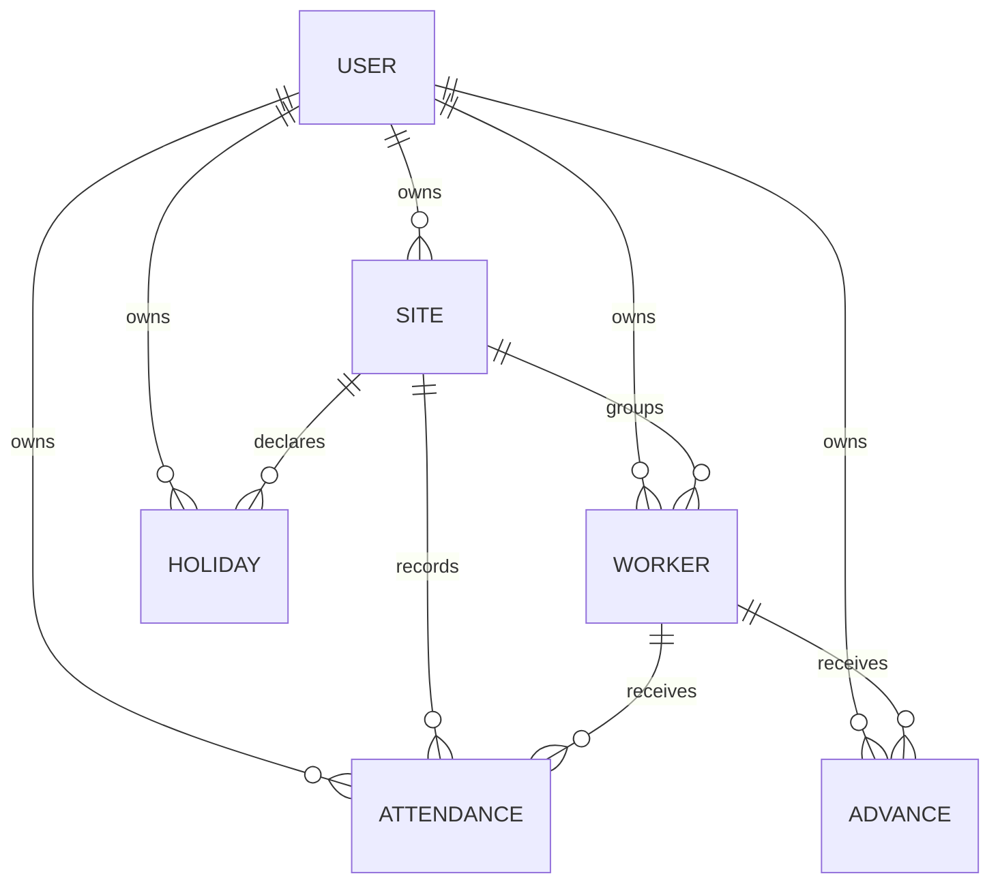

# SiteBook

SiteBook is a mobile-first site attendance and wage tracking app for teams working across construction or other field sites. It helps a site manager record daily worker attendance, manage site and worker details, track advances and holidays, and prepare monthly pay reports.

## The Problem

Field attendance and wage records are often kept in paper registers or disconnected spreadsheets. That makes it harder to:

- Keep daily attendance tied to the correct worker, site, and date.
- Calculate monthly wages consistently when half-days, overtime, holidays, and advances are involved.
- Review and share reports without manually rebuilding them.
- Retain a recoverable copy of records when a device is replaced or data needs to be restored.

## The Solution

SiteBook provides one mobile workflow for site setup, worker management, daily attendance, and monthly reporting. It stores user-owned records in Cloud Firestore, listens for live updates, and can optionally create a JSON backup in the user's Google Drive. Reports can be generated as PDF or Excel files and shared from the device.

The app also includes a local PIN unlock screen, secure storage for Google OAuth tokens on supported devices, date-aware holiday and Sunday handling, and duplicate-resistant attendance writes.

## Product Novelty

The value is in bringing field operations and pay preparation together in a focused workflow: attendance is recorded against active site workers, then combined with wage rates, overtime, holidays, and advances to produce shareable monthly summaries. The optional Drive backup and exports keep the workflow usable without making every manager depend on a separate spreadsheet process.

This describes the product's practical differentiation; it is not a claim of patent novelty or a formal comparison against every competing product.

## Architecture

The app is an Expo / React Native client. Screens use a shared context for live site, worker, advance, and holiday data. Service modules isolate Firebase authentication, Firestore operations, Google sign-in and Drive backup, secure token storage, notifications, and report generation.

### Main Data Flow

### Data Model

Each Firestore record is scoped by `userId`; related records are associated by IDs. Firestore security rules require the authenticated UID to match the record owner for reads and writes.

Collections used by the app are `sites`, `workers`, `attendance`, `advances`, and `holidays`. Attendance records contain a date, status, overtime hours, and a `yearMonth` key for monthly queries and exports.

## Repository Layout

- `App.js`: app bootstrap, auth state, PIN gate, and navigation root.
- `src/screens/`: Attendance, Workers, Report, More, and PIN workflows.
- `src/components/`: shared form and presentation components.
- `src/context/AppContext.js`: live shared app data and selected site.
- `src/services/`: Firebase, Firestore, auth, Drive sync, secure storage, PDF, Excel, and notifications.
- `src/utils/`: date, wage, and PIN helpers.
- `firestore.rules`: user-ownership access checks.
- `firestore.indexes.json`: indexes required by Firestore queries.
- `app.config.js`: injects local environment values into Expo configuration.

## Local Setup

Prerequisites: Node.js, npm, an Expo-compatible Android or iOS development environment, and access to the Firebase project used by this app.

1. Install packages with `npm install`.
2. Copy `.env.example` to `.env` and fill in the Firebase and Google OAuth client values from the relevant Firebase and Google Cloud console projects.
3. Download the Android Firebase client configuration as `google-services.json` in the project root. This file is ignored by Git. If needed, set `GOOGLE_SERVICES_JSON` to another local path.
4. Configure Firestore Authentication providers, deploy `firestore.rules`, and deploy `firestore.indexes.json` to the Firebase project.
5. Start Expo with `npm start`, or use `npm run android` for a native Android development build.

For remote EAS builds, add the `EXPO_PUBLIC_*` values as EAS environment variables for the build environment. Add the Firebase Android JSON as an EAS file environment variable named `GOOGLE_SERVICES_JSON`; the dynamic Expo config uses that path. The local `.env` and ignored Firebase JSON file are not a substitute for configuring the remote build environment.

Google sign-in requires valid client IDs for the platforms being built and a matching redirect configuration. iOS builds also require the appropriate native Google sign-in URL scheme setup if the chosen OAuth configuration needs one.

## Security Notes

- `.env` and Firebase JSON configuration files are excluded from Git. `.env.example` contains placeholders only.
- `EXPO_PUBLIC_*` values are bundled into a client app and can be extracted. Firebase API keys and OAuth client IDs identify the client; they are not server-side secrets. Restrict Firebase API keys where applicable, enforce Firebase Auth and Firestore rules, and never put service-account keys, private OAuth client secrets, or admin credentials in this app.
- Google access and refresh tokens are stored with Expo SecureStore on supported native platforms. Web uses a browser-compatible fallback and does not provide the same at-rest protection.
- Google Drive backup is optional and stores a user-scoped data export in the signed-in user's Drive.
- Android release signing must use a production keystore managed through the build system's secure credential mechanism. The checked-in Gradle configuration currently points the release build type at the debug signing config; replace that before distributing a production Android build.
- If Firebase or Google client values were ever committed to a public repository, rotate or restrict them as appropriate. Adding `.gitignore` does not remove files from previous Git history.

## Available Commands

- `npm start`: start the Expo development server.
- `npm run android`: build and run the Android app locally.
- `npm run build:apk`: create an EAS preview APK.
- `npm run build:aab`: create an EAS production-profile Android build (the current EAS profile specifies APK output).